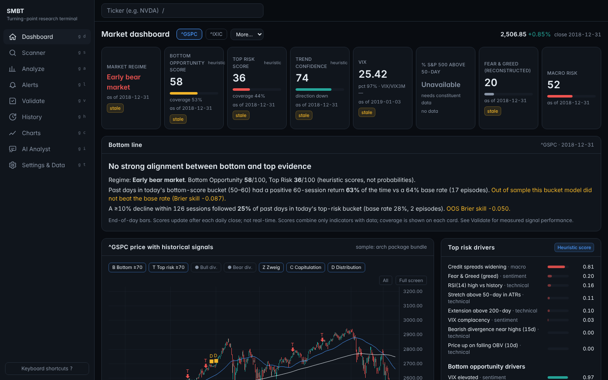
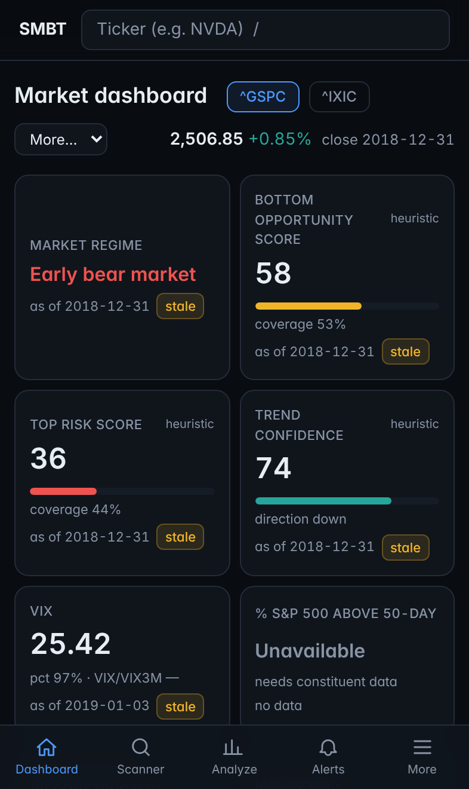

# SMBT — Market Top & Bottom Research Terminal

Installable PWA (iPhone + Windows/desktop) backed by a Python quant engine that answers one question:

> *Based on all currently available evidence and historically validated indicators, how attractive or dangerous is this market right now?*

It separates three kinds of evidence everywhere in the UI and API, and never mixes them:

| Kind | What it is | Example |
|---|---|---|
| **Heuristic score** | Regime-weighted composite of point-in-time indicator percentiles (0–100). Not a probability. | Bottom Opportunity 58, Top Risk 36 |
| **Empirical frequency** | Counted from history with episode-level CIs, validated walk-forward (Brier skill vs base rate). | "63% of past days in this bucket had a positive 60d return; base rate 64%; OOS Brier skill −0.09" |
| **Historical similarity** | Nearest past dates by feature fingerprint and what followed (distributions, not averages). | "Closest: 2011-09-30 (debt-ceiling correction), 2015-09-01…" |

| Desktop | iPhone |
|---|---|
|  |  |

*(Screenshots come from the automated browser test, which feeds 1999–2018 index history through the provider interface, so every card correctly reads STALE.)*

**Live and stateless.** Prices stream from Alpaca or Massive over WebSockets into a server hub and out to each browser; history, fundamentals, options and macro are fetched from licensed APIs on demand and held only in process memory. Every value carries LIVE / DELAYED / STALE / CLOSED / UNAVAILABLE plus an inspectable source, event time, session, delay and method. No accounts, no database, no browser storage, no tracking.

## What's in it

- **Dashboard**: live quote header; regime, Bottom Opportunity / Top Risk / Trend Confidence, VIX, breadth, reconstructed Fear & Greed, macro risk, each with a status badge and a "source & method" inspector; intraday cards update as provisional values while the confirmed close stays visible. Daily candlestick chart whose last candle follows the stream, 1-minute intraday chart, historical signal markers (tap one to see which indicators triggered it and what happened next).
- **Indicator engine** (all causal, truncation-tested): RSI + divergences, MACD + divergences, Stoch RSI, Bollinger, 20/50/100/200 MAs, distance from 200d, anchored VWAP, ATR, ADX, volume profile, OBV/volume-price divergence, historical vol, relative strength.
- **Breadth** from S&P 500 members (point-in-time membership from FMP): % above 20/50/200d, A/D line, McClellan Oscillator & Summation, new highs−lows, Zweig Breadth Thrust, % oversold/overbought, 90% down days, breadth divergence at highs; intraday version from constituent snapshots.
- **Sentiment & macro**: VIX & term structure (Cboe; live with Massive Indices), F&G reconstruction; yield curve (+ un-inversion), Fed funds, real yields, credit spreads, NFCI, Sahm gap, CPI/core CPI, Philly Fed manufacturing, net liquidity, M2, market cap/GDP, all **point-in-time** (ALFRED first-release vintages or conservative publication lags) and dropped once older than each series' release cycle allows.
- **Validation**: walk-forward parameter selection, purged time-series CV, costs + slippage, next-open execution, block-bootstrap CIs vs buy & hold (SPY/QQQ), bull/bear split, event studies vs random entries with Benjamini–Hochberg FDR, turning-point precision/recall/lag.
- **Analyze any ticker** (search via Massive/FMP): live quote; normal pullback vs possible accumulation vs structural decline vs potential exhaustion, with forward-return stats for that state on that symbol and an intraday re-read; sector and relative strength; fundamentals (FMP); options put/call, ATM IV and dealer gamma (Massive Options).
- **Scanner**: 9 setup types across the universe (daily/weekly), ranked by pooled historical evidence; filter by type, cap, sector, signal, ticker.
- **Historical analogs**: closest periods incl. dot-com, GFC, COVID, 2022, with 5–252 day outcome distributions.
- **Alerts** (session-only): score crosses, VIX range, breadth extremes, divergences, regime changes, watchlist setups, edge-triggered with hysteresis, cooldowns and a daily cap, delivered over the page's WebSocket as local notifications while it is open. Nothing is stored.
- **AI analyst** (Claude): answers only from tool calls into the app's own computed data, cites each tool/as-of date, presents bull and bear evidence.
- **PWA**: installable, full-screen, bottom nav on phones, sidebar + keyboard shortcuts on desktop (`?`), dark/light; reconnects and resubscribes when a phone wakes; the service worker caches only the app shell, never data.

## Measured, not claimed

`python -m app.cli report <SYMBOL>` prints the signal scoreboard and walk-forward results from live provider history. On 1999–2018 S&P 500 and NASDAQ Composite history (v1) **no timing strategy beat buy-and-hold CAGR out of sample**, and the one signal with a significant S&P 500 event-study edge (Bottom score ≥ 70, p = 0.015, q = 0.09, 20 events) **did not replicate on the NASDAQ** (p = 0.42). Numbers and caveats: [docs/METHODOLOGY.md](docs/METHODOLOGY.md#historical-results-v1-19992018-index-history). Results on current data will differ; the app shows whatever the data says.

## Get it running

- **Windows PC**: run `SMBT-Setup.exe` (build it with `packaging/windows/build.sh`, or download the `SMBT-Setup` artifact from the *windows-app* GitHub Actions run). Per-user install, no admin; opens at `http://127.0.0.1:8765` in personal mode. Add provider keys in Start menu → *SMBT settings*, then restart. Unsigned, so SmartScreen asks once (More info → Run anyway).
- **iPhone / any device, full terminal**: deploy the server ([docs/DEPLOY.md](docs/DEPLOY.md)), or reach the PC app through Tailscale, open its HTTPS URL and add it to the home screen.
- **iPhone inside the Claude app, no server**: `packaging/artifact/build/` is a one-page version published as a Claude artifact. It reads quotes and daily history through the viewer's own **Alpha Vantage** claude.ai connector (add it under Settings → Connectors with your key) and shows the quote with its status, a daily chart, indicators and the stock-state rules. It has no streaming, breadth, macro or scores; Alpha Vantage free keys allow 25 requests a day and only the last 100 daily sessions.

Which subscriptions you need, what each one unlocks, and what you may legally show to other people: [docs/DATA_SOURCES.md](docs/DATA_SOURCES.md). What changed from v1 and how it is verified: [docs/DATA_AUDIT.md](docs/DATA_AUDIT.md).

## Quick start (local)

```bash
cp .env.example .env              # add at least one equity provider (e.g. free Alpaca IEX + Tiingo)
cd frontend && npm install && npm run build && cd ..
cd backend
python -m venv .venv && . .venv/bin/activate
pip install -r requirements.txt pytest
python -m app.cli check           # live check of every configured provider and stream
uvicorn app.main:app              # http://localhost:8000 (PWA + API + /ws)
```

Without keys the server still starts: Cboe VIX and FRED macro load, and every equity view says UNAVAILABLE with the reason.

Tests: `cd backend && python -m pytest` (93 tests: provider parsers, stream/hub rules, a fake-upstream pipeline, and a real-browser run of the built PWA on desktop and iPhone viewports) · `cd frontend && npm test && npx tsc --noEmit`.

Deploy (single Docker container + HTTPS): [docs/DEPLOY.md](docs/DEPLOY.md).

## Layout

```
backend/app/
  market/      unified data layer: model, providers (Alpaca, Massive, Tiingo, Cboe, FRED, FMP), stream clients,
               hub, history, macro (point-in-time), reference, analytics (breadth, options), calendar, licensing
  ws.py        browser WebSocket: subscriptions, batched fan-out, session alerts
  quant/       technical, breadth, macro/sentiment, scores & regime, probabilities, analogs
  backtest/    engine (next-bar execution, costs), strategies, validation (walk-forward, CV, events, pivots)
  scanner.py alerts.py analyst.py services.py main.py cli.py desktop.py
backend/tests/ tests; fixtures/ holds real 1999-2018 history used only by tests
frontend/      Next.js 16 static export (App Router, Tailwind 4, lightweight-charts 5); lib/live.ts is the WebSocket client
```

Research software, not investment advice.
